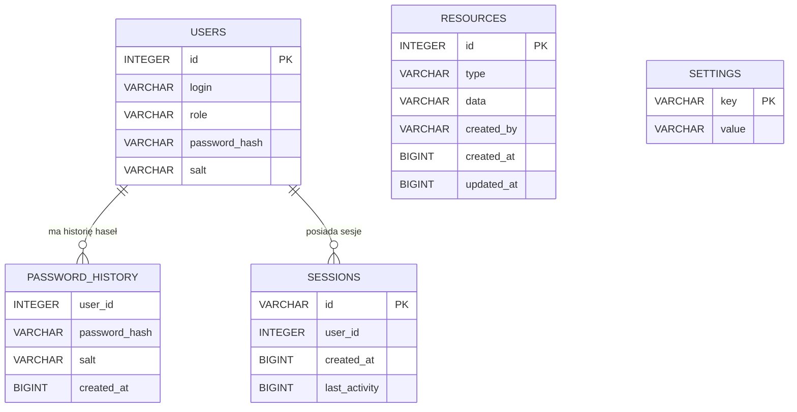

# CYB_Projekt

Projekt na zaliczenie przedmiotu Cyberbezpieczeństwo.


## Stack technologiczny

| Warstwa | Technologie | Rola w aplikacji |
|---|---|---|
| Środowisko uruchomieniowe | Node.js 20+ | Uruchamianie klienta i serwera. |
| Backend | JavaScript, CommonJS, Express 5 | REST API, walidacja danych, uwierzytelnianie i autoryzacja. |
| Baza danych | DuckDB (`duckdb` dla Node.js) | Lokalna, plikowa baza danych aplikacji (`server/data/app.duckdb`). |
| Uwierzytelnianie | JWT (`jsonwebtoken`), `crypto.scrypt` | Token sesji podpisywany HS256; hasła przechowywane jako hash scrypt z losową solą. |
| Bezpieczeństwo transportu API | CORS (`cors`), Bearer token | Ograniczenie źródeł klienta i przekazywanie tokenu w nagłówku `Authorization`. |
| Frontend | React 19, Create React App (`react-scripts` 5) | Interfejs SPA i obsługa stanu widoków. |
| Komponenty i style | MUI 9, Emotion, Tailwind CSS 3, PostCSS, Autoprefixer | Komponenty formularzy/tabel/dialogów oraz układ i responsywne style. MUI `CssBaseline` zastępuje Tailwindowy preflight. |
| Ikony | `lucide-react` | Ikony nawigacji, zasobów i akcji. |
| Testy | Node.js test runner, React Testing Library, Jest (przez CRA) | Testy API i komponentów klienta. |
| Web Vitals | `web-vitals` | Opcjonalne pomiary wydajności klienta. |

Komunikacja odbywa się przez HTTP/JSON: klient korzysta domyślnie z `http://localhost:4000/api`, a adres można zmienić przez `REACT_APP_API_URL`. Frontend jest aplikacją React typu SPA.

## Schemat bazy danych

Baza jest inicjalizowana przy starcie backendu przez `server/src/db.js`. Domyślnie jest to plik `server/data/app.duckdb`; ścieżkę można nadpisać zmienną `DB_FILE`. Identyfikatory użytkowników i zasobów pochodzą z sekwencji `users_seq` i `resources_seq`. Czas jest zapisywany jako Unix epoch w milisekundach (`BIGINT`).

### Tabele

| Tabela | Kolumny | Przeznaczenie |
|---|---|---|
| `users` | `id INTEGER PK`; `login`, `first_name`, `last_name`, `role`, `password_hash`, `salt` (`VARCHAR NOT NULL`); `must_change_password`, `blocked` (`BOOLEAN NOT NULL`, domyślnie `FALSE`); `one_time_expires BIGINT NULL`; `password_changed_at`, `created_at` (`BIGINT NOT NULL`) | Konta, role, dane weryfikacyjne hasła, blokada konta i daty ważności. Hasła jawne nie są zapisywane. |
| `password_history` | `user_id INTEGER NOT NULL`, `password_hash VARCHAR NOT NULL`, `salt VARCHAR NOT NULL`, `created_at BIGINT NOT NULL` | Poprzednie hashe haseł. Przy zmianie hasła serwer sprawdza ponowne użycie względem historii. Tabela nie ma własnego klucza głównego. |
| `sessions` | `id VARCHAR PK`, `user_id INTEGER NOT NULL`, `created_at BIGINT NOT NULL`, `last_activity BIGINT NOT NULL` | Sesje powiązane z identyfikatorem `sid` z JWT; aktywność jest używana do automatycznego wylogowania. |
| `resources` | `id INTEGER PK`; `type`, `data`, `created_by` (`VARCHAR NOT NULL`); `created_at`, `updated_at` (`BIGINT NOT NULL`) | Dokumenty, projekty i urządzenia. `data` zawiera serializowany JSON o polach zależnych od typu zasobu. |
| `settings` | `key VARCHAR PK`, `value VARCHAR NOT NULL` | Ustawienia systemu, w tym polityka haseł, minimalna długość, ważność hasła i limit bezczynności sesji. W tej tabeli przechowywany jest także wygenerowany sekret JWT, jeśli `JWT_SECRET` nie został podany w środowisku. |

### Relacje i zasoby



`resources.type` przyjmuje klucze `documents`, `projects` albo `devices`; backend waliduje strukturę JSON według definicji danego typu. Dokumenty zawierają m.in. tytuł, kategorię, autora i status; projekty — nazwę, kierownika, budżet, daty i status; urządzenia — nazwę, rodzaj, numer seryjny, lokalizację i stan.

Relacje `users`–`password_history` oraz `users`–`sessions` są relacjami logicznymi opartymi o `user_id`; w obecnej inicjalizacji schematu DuckDB nie deklaruje się ograniczeń `FOREIGN KEY`. `resources.created_by` przechowuje login autora, nie klucz obcy. `settings` i `resources` nie mają relacji z użytkownikiem na poziomie constraintów bazy.

Schemat nie deklaruje ograniczenia `UNIQUE` dla `users.login`; API sprawdza duplikaty loginów bez rozróżniania wielkości liter podczas tworzenia użytkownika.

## Uruchomienie

Wymagany Node.js 20+.

### Serwer (REST API, port 4000)

```
cd server
npm install
npm start
```

Przy pierwszym starcie tworzona jest baza `server/data/app.duckdb` oraz konta początkowe; ich dane logowania są wypisywane w konsoli i zapisywane w `server/data/initial-credentials.txt` (katalog jest w `.gitignore`):

- `ADMIN` (Administrator) – hasło jednorazowe (16 znaków, ważne 12 h), wymusza zmianę przy pierwszym logowaniu,
- 6 kont testowych: `jkowalski`, `anowak` (Kierownik), `pwisniewski`, `mzielinska` (Pracownik), `kmazur`, `ewojcik` (Gość). Pierwszych pięć ma hasło `Test-Haslo#2026`, `ewojcik` – hasło jednorazowe z konsoli.

Utracone hasło ADMIN: `npm run reset-admin`. Aby zacząć od zera, usuń katalog `server/data`.
Podgląd bazy w konsoli (serwer musi być zatrzymany, bo DuckDB pozwala na dostęp z jednego procesu): `npm run show-db` (wszystkie tabele), `npm run show-db -- users`, `npm run show-db -- resources --json`. Macierz uprawnień ról: [PERMISSIONS.md](PERMISSIONS.md).
Testy: `npm test`. Zmienne środowiskowe: `PORT`, `JWT_SECRET`, `CLIENT_ORIGIN`, `DB_FILE`.

### Klient (port 3000)

```
cd client
npm install
npm start
```

Adres API można zmienić zmienną `REACT_APP_API_URL` (domyślnie `http://localhost:4000/api`).

## Zaimplementowane funkcje

- Logowanie z maskowanym hasłem; błąd: „Login lub hasło niepoprawne”; hasła jako scrypt + sól; ograniczenie prób (5 błędnych / 5 min).
- Wymuszona zmiana hasła po logowaniu hasłem jednorazowym (nowe hasło podawane dwukrotnie) oraz po upływie ważności hasła.
- Zmiana hasła (wymaga starego hasła, polityka z ustawień, nowe różne od wszystkich poprzednich).
- Panel administratora: lista, dodawanie, edycja, blokowanie, reset hasła i usuwanie użytkowników; ustawienia: polityka haseł (włącz/wyłącz, min. długość), ważność hasła w dniach, czas bezczynności sesji. Konto ADMIN jest chronione.
- Rejestracja kont odbywa się wyłącznie przez administratora (brak samodzielnej rejestracji).
- Sesja: JWT powiązany z sesją na serwerze; wylogowanie ręczne i automatyczne po bezczynności (kontrola po stronie serwera i klienta).
- Zasoby trzech typów (Dokumenty, Projekty, Urządzenia), każdy z innymi polami.

### Uprawnienia ról

| Rola          | Zasoby: odczyt | dodawanie | edycja | usuwanie | Użytkownicy i ustawienia |
|---------------|:---:|:---:|:---:|:---:|:---:|
| Administrator | ✔ | ✔ | ✔ | ✔ | ✔ |
| Kierownik     | ✔ | ✔ | ✔ | ✔ |   |
| Pracownik     | ✔ | ✔ | ✔ |   |   |
| Gość          | ✔ |   |   |   |   |

## Wymagania

### Polecenie

Napisz aplikację z dwiema rolami: administrator (stałe konto ADMIN) i zwykły użytkownik. Aplikacja ma realizować:

1. Logowanie - login i maskowane hasło; przy błędzie komunikat „Login lub hasło niepoprawne”; hasła przechowywane jako hash z solą.

2. Pierwsze logowanie - wymuszona zmiana hasła nadanego przez administratora; nowe hasło podawane dwukrotnie.

3. Zmiana hasła - wymaga starego hasła; nowe musi spełniać politykę z wariantu i różnić się od poprzednich.

4. Panel administratora - lista, dodawanie, edycja, blokowanie i usuwanie użytkowników; włączanie polityki haseł z wariantu; ważność hasła w dniach; czas bezczynności sesji.

5. Hasło jednorazowe - nadawane przez administratora przy tworzeniu konta lub resecie, w formacie z wariantu i z ograniczoną ważnością.

6. Role i uprawnienia - zaimplementowane role i uprawnienia z wariantu.

7. Sesja - wylogowanie ręczne i automatyczne po bezczynności.

Zadanie dodatkowe (na ocenę bardzo dobrą): uwierzytelnianie dwuskładnikowe TOTP.

### Stan aplikacji

- Zasoby: różnego typu, jedna lista ze wszystkimi zasobami jednego typu nie wystarczy
- Role: Administrator, Kierownik, Pracownik, Gość
- Liczba testowych użytkowników: 6


### Polityka haseł

- Domyślna minimalna długość: 12 znaków
- Nie może zawierać imienia, nazwiska ani loginu użytkownika (niezaleźnie od wielkości liter).
- Hasło jednorazowe: 16 znaków (litery, cyfry, znaki specjalne), ważne 12h